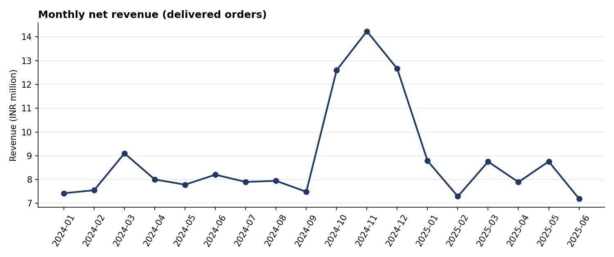
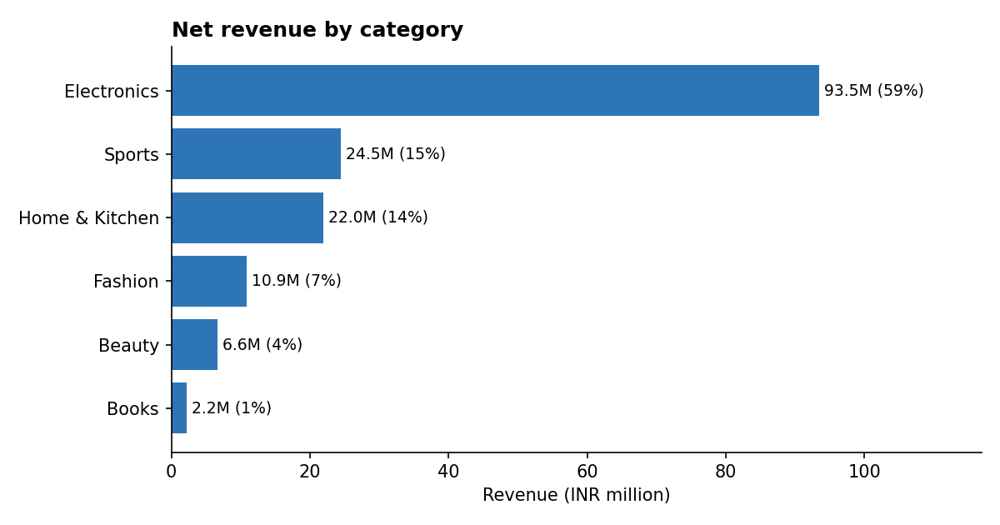
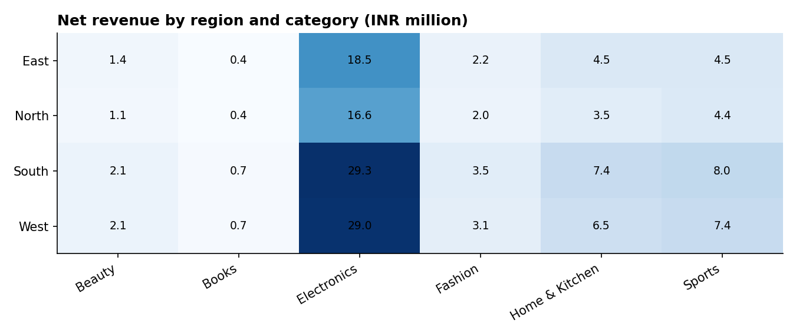
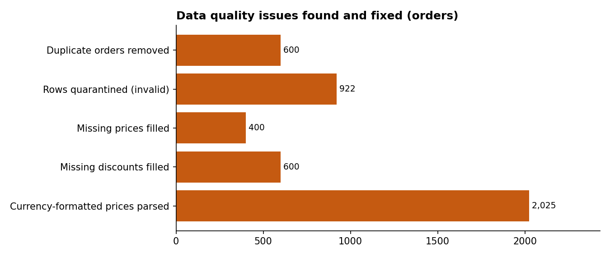

# Sales Data Cleaning, SQL & Excel Reporting Pipeline

An end-to-end data analyst project: messy data from **3 sources** (orders, customers, products) is cleaned and
validated with **Python (Pandas)**, loaded into a **SQLite** database, analysed with **10 SQL queries**
(joins, aggregations, CTEs, window functions) and delivered as an **Excel dashboard**.
One command runs everything.

> **Data note:** the raw files are **synthetic** (generated by `generate_data.py`) with realistic data-quality
> problems injected on purpose. The pipeline can be pointed at a real dataset (see "Use your own data").

## Run it

```bash
pip install -r requirements.txt
python generate_data.py     # optional: recreate the messy raw files
python run_pipeline.py      # clean -> validate -> SQLite -> SQL -> charts -> Excel
```

## Results

| Metric | Value |
|---|---:|
| Raw orders | 20,600 |
| Clean orders loaded | 19,078 |
| Duplicate order rows removed | 600 |
| Invalid rows quarantined (with reason) | 922 |
| Customers (raw -> clean) | 6,040 -> 6,000 |
| Delivered orders | 16,282 |
| Net revenue | INR 159,591,018 |
| Average order value | INR 9,802 |
| Repeat-customer rate | 71.1% |
| Top category | Electronics (58.6% of revenue) |






## Data quality: what was fixed

| Issue | Count | Fix |
|---|---:|---|
| Duplicate order rows (hidden by stray spaces in IDs) | 600 | De-duplicated on trimmed, upper-cased `order_id` |
| Duplicate customer rows | 40 | De-duplicated on `customer_id` |
| Mixed date formats (3) | all rows | Parsed to ISO `YYYY-MM-DD` |
| Prices with currency symbols or commas | 2,025 | Parsed to numbers |
| Missing unit prices | 400 | Filled from product master |
| Missing discounts | 600 | Assumed 0% (documented) |
| Status labels | 16 -> 4 | Standardised |
| Payment labels | 16 -> 5 | Standardised |
| City labels | 31 -> 8 | Standardised, mapped to region |
| Category labels | 14 -> 6 | Standardised |
| Invalid / missing emails | 234 / 180 | Set to blank |

Rows that break a business rule are **not silently dropped**: they go to `data/rejected/orders_rejected.csv`
with a `reject_reason` (missing quantity, quantity out of range, bad or future date, unknown product or
customer, impossible discount). After cleaning, 14 validation
checks run (unique keys, no nulls, valid ranges, foreign keys, order value recomputation) and the pipeline stops if any fail.
Full detail: `reports/data_quality_report.md`.

## SQL queries (`sql/queries.sql`)

| # | Query | Techniques |
|---|---|---|
| 1 | Overall KPIs | Aggregations |
| 2 | Monthly revenue with month-over-month growth | CTE, `LAG()` |
| 3 | Revenue and share by category | JOIN, `SUM() OVER ()` |
| 4 | Revenue by region and category | 3-table JOIN, GROUP BY |
| 5 | Top 10 customers | `RANK()` |
| 6 | Top 3 products per category | `ROW_NUMBER() OVER (PARTITION BY ...)` |
| 7 | Repeat-customer rate | CTE, conditional aggregation |
| 8 | Cumulative revenue by month | Running total window |
| 9 | Cancellation and return rate by region | Conditional aggregation |
| 10 | Customers who never ordered | LEFT JOIN anti-join |

Results are exported to `reports/sql_results/`. The database has primary keys, foreign keys and indexes.

## Excel dashboard (`reports/sales_dashboard.xlsx`)

- **Dashboard:** KPIs, monthly, category and region x category tables built with live `SUMIFS`/`COUNTIFS`
  formulas, two charts and a colour-scale heatmap.
- **Clean_Data:** 19k+ rows stored as an Excel Table named `SalesClean`.
- **Data_Quality:** issues found, actions taken and validation results.
- **Top_Customers_SQL:** output of the SQL ranking query.

**Add a real PivotTable (2 minutes):** open `Clean_Data`, click any cell, Insert > PivotTable. Set Rows = `category`,
Columns = `region`, Values = Sum of `order_value`, Filter = `status` (Delivered). Then screenshot it into `docs/pivot_table.png`.

## Business rules and assumptions

- Net revenue counts only `Delivered` orders.
- Dates with `/` are read as DD/MM/YYYY.
- Missing discount means 0%.
- Valid quantity is 1-50, valid discount is 0-50%, valid date range is 2024-01-01 to 2025-12-31.

## Use your own data

Replace the CSVs in `data/raw/` with a real dataset (for example a Kaggle sales or e-commerce dataset). Then update
the column names and label mappings at the top of `run_pipeline.py`, and run it again. The numbers in this README will
change, so regenerate them.

## Project structure

```
generate_data.py      messy synthetic raw data
run_pipeline.py       clean, validate, load, analyse, report
sql/queries.sql       10 analysis queries
data/raw|clean|rejected
db/sales.db           SQLite database
reports/              quality report, SQL results, Excel dashboard
docs/                 charts
```


docs/dashboard.png